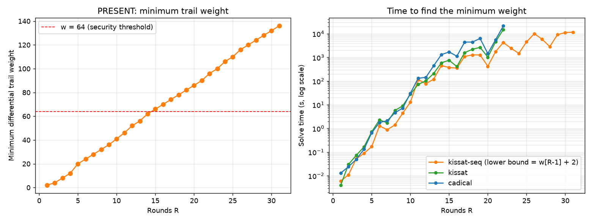

# PRESENT differential cryptanalysis by SAT

Automatic search for **optimal differential trails** on the [PRESENT](https://doi.org/10.1007/978-3-540-74735-2_31)
block cipher, by encoding the problem as SAT/CNF and solving it with **Kissat** and **CaDiCaL** (via PySAT).
For each number of rounds R = 1..31 it finds the minimum number of active S-boxes and the minimum trail weight
(trail probability = 2^-weight), and can print an optimal trail.

It doubles as a small controlled comparison: three solver configurations (Kissat, CaDiCaL, and Kissat with a
sequential lower bound) run on the same instances, every minimum is checked against published values, and the
limitations of the measurements are listed [below](#limitations).

Originally a course project (EPITA, Constraint Programming, 2026). Slides (in French): [slides.pdf](slides.pdf).
The analysis notebook ([notebook.ipynb](notebook.ipynb)) is written in English.



*Generated from `benchmark.json` by [`scripts/plot_benchmark.py`](scripts/plot_benchmark.py).*

## Results

All figures below are computed from [`benchmark.json`](benchmark.json) (one run per configuration; hardware not recorded).

- **Minimum weights match the literature for all R = 1..31.** The values (2, 4, 8, 12, 20, 24, 28, 32, 36, 41, 46,
  52, 56, 62, 66, ..., 96, ..., 136) are identical to the best differential weights of PRESENT reported by
  [Kim et al. (ToSC 2022)](https://doi.org/10.46586/tosc.v2022.i2.201-252). Minimum active S-box counts
  (1, 2, 4, 6, 10, 12, 14, ..., 62) match [Zhou et al. (ToSC 2019)](https://doi.org/10.13154/tosc.v2019.i4.438-469),
  with identical results for Kissat and CaDiCaL.
- **Security threshold (w > 64) is reached at R = 15**: w_min(14) = 62, w_min(15) = 66. At 16 rounds the minimum
  trail weight is 70.
- **Benchmark on 31 rounds: yes, with `kissat-seq` only** (R = 31: w_min = 136, 11,716 s for that round; 70,822 s for
  R = 1..31 cumulated). Plain `kissat` and `cadical` were benchmarked up to R = 22.
- **Gain of the `kissat-seq` lower bound** (w[R-1] + 2 instead of 2 x min_active[R]), rounds 1-22, summed over rounds:
  `kissat-seq` 11,588 s vs `kissat` 29,370 s, i.e. **2.5x faster** overall, and **3.6x at R = 22**
  (4,257 s vs 15,152 s). Against `cadical`: 4.2x overall, 5.0x at R = 22. Per round, `kissat-seq` is faster in 20 of
  22 rounds (median ratio 1.9x; exceptions R = 1 and R = 11).
  Single-run timings are noisy (e.g. R = 20 is faster than R = 19), so treat per-round ratios as indicative.

Selected rounds (full table at the end of this section):

| R | min. weight | kissat-seq (s) | kissat (s) | kissat / kissat-seq |
|--:|--:|--:|--:|--:|
| 5 | 20 | 0.170 | 0.717 | 4.22x |
| 10 | 41 | 12.9 | 27.8 | 2.15x |
| 14 | 62 | 453.3 | 590.0 | 1.30x |
| 15 | 66 | 373.6 | 761.2 | 2.04x |
| 16 | 70 | 353.2 | 409.4 | 1.16x |
| 20 | 86 | 424.2 | 1,025.0 | 2.42x |
| 22 | 96 | 4,256.5 | 15,152.2 | 3.56x |
| 31 | 136 | 11,715.5 | - | - |

<details>
<summary>All rounds</summary>

| R | min. weight | kissat-seq (s) | kissat (s) | kissat / kissat-seq |
|--:|--:|--:|--:|--:|
| 1 | 2 | 0.006 | 0.004 | 0.67x |
| 2 | 4 | 0.011 | 0.030 | 2.73x |
| 3 | 8 | 0.052 | 0.073 | 1.40x |
| 4 | 12 | 0.088 | 0.164 | 1.86x |
| 5 | 20 | 0.170 | 0.717 | 4.22x |
| 6 | 24 | 1.3 | 2.3 | 1.79x |
| 7 | 28 | 0.880 | 1.7 | 1.96x |
| 8 | 32 | 1.4 | 5.7 | 4.05x |
| 9 | 36 | 4.4 | 8.9 | 2.04x |
| 10 | 41 | 12.9 | 27.8 | 2.15x |
| 11 | 46 | 116.1 | 72.3 | 0.62x |
| 12 | 52 | 77.3 | 102.5 | 1.33x |
| 13 | 56 | 120.7 | 208.9 | 1.73x |
| 14 | 62 | 453.3 | 590.0 | 1.30x |
| 15 | 66 | 373.6 | 761.2 | 2.04x |
| 16 | 70 | 353.2 | 409.4 | 1.16x |
| 17 | 74 | 1,094.2 | 1,590.7 | 1.45x |
| 18 | 78 | 1,281.4 | 2,193.8 | 1.71x |
| 19 | 82 | 1,265.4 | 2,661.3 | 2.10x |
| 20 | 86 | 424.2 | 1,025.0 | 2.42x |
| 21 | 90 | 1,750.4 | 4,554.8 | 2.60x |
| 22 | 96 | 4,256.5 | 15,152.2 | 3.56x |
| 23 | 100 | 2,434.0 | - | - |
| 24 | 106 | 1,482.9 | - | - |
| 25 | 110 | 4,516.6 | - | - |
| 26 | 116 | 9,983.3 | - | - |
| 27 | 120 | 5,944.8 | - | - |
| 28 | 124 | 2,853.7 | - | - |
| 29 | 128 | 9,183.8 | - | - |
| 30 | 132 | 11,119.6 | - | - |
| 31 | 136 | 11,715.5 | - | - |

</details>

## Limitations

- **One run per configuration, hardware not recorded.** Timings are indicative: single runs are noisy (R = 20 is faster than R = 19 for all solvers), so only large ratios are meaningful.
- **Partial coverage.** Plain `kissat` and `cadical` stop at R = 22; the R = 23..31 results come from `kissat-seq` alone, and the speed-up figures cover R = 1..22 only.
- **Literature tables as starting bounds.** The default lower bound `2 x min_active[R]` and the first bound of `--seq` / `--cached` come from `ACTIVE_BOUNDS` / `WEIGHT_BOUNDS` in `search.py`. The search then goes upward linearly, so the first satisfiable weight is the minimum only if the starting bound is valid. The active S-box counts were also recomputed by the SAT solvers (Kissat and CaDiCaL agree), and the tests recompute the minimum weights for R <= 4 with the tables emptied.
- **Agreement with the literature is a validation, not a proof of the encoding.** The encoding is checked against the DDT, the official PRESENT test vectors and a direct evaluation of the clauses (see the tests), but not formally verified.
- **Environment.** Requires `python-sat >= 1.9.dev2` (a development pre-release, pinned in `uv.lock`) for the Kissat backend; Unix only (signal handling in the CLI).

## How it works

- Each PRESENT round is encoded in CNF: the S-box through its difference distribution table (DDT), reduced to
  prime-implicant clauses with Quine-McCluskey; the bit permutation is just variable renaming.
- Each S-box has an `active` flag and a `heavy` flag (DDT entry 2, weight 3 instead of 2); the weight is
  2 x active + heavy, bounded with a pseudo-Boolean constraint.
- Minimum active S-boxes: binary search with a cardinality constraint. Minimum weight: linear search upward from a
  lower bound. Since w_min(R) >= w_min(R-1) + 2, the `--seq` / `--cached` modes start the search from the previous
  round's weight.

```
present_sat/
  present.py    PRESENT: S-box, DDT, bit permutation, encryption, trail validation
  encoding.py   CNF model (DDT clauses, weights, trail decoding)
  search.py     min active S-boxes (binary search) and min trail weight (linear search)
  display.py    live terminal table and benchmark rendering
  main.py       CLI
tests/          pytest suite (cipher, encoding, CLI, SAT searches on small R)
scripts/        plot_benchmark.py
benchmark.json  precomputed results (kissat-seq R=1..31, kissat and cadical R=1..22)
```

## Install and run

Requires Python >= 3.13 and [uv](https://docs.astral.sh/uv/).

```bash
uv sync
uv run python -m present_sat --benchmark        # print the saved benchmark tables
uv run python -m present_sat --weight --rmax 8  # recompute min weights for R=1..8 (seconds)
```

```bash
# Minimum number of active S-boxes, rounds 1 to 31
uv run python -m present_sat --active --rmin 1 --rmax 31

# Minimum trail weight (default lower bound: 2 * min_active[R])
uv run python -m present_sat --weight

# Sequential mode (kissat-seq): round R uses weight[R-1] as lower bound. Single worker, since weight[R]
# has to wait for weight[R-1].
uv run python -m present_sat --weight --seq

# Parallel variant of the same optimisation: weight[R-1] is taken from a cache as soon as it is available.
uv run python -m present_sat --weight --cached

# Print an optimal trail, with CaDiCaL
uv run python -m present_sat --trail --solver cadical

# Number of worker processes (default: cpu_count // 3)
uv run python -m present_sat --weight --workers 4

# Show saved results
uv run python -m present_sat --benchmark
uv run python -m present_sat --benchmark path/to/other.json
```

### Options

| Option | Description |
|---|---|
| `--rmin`, `--rmax` | Range of rounds to analyse (default: 1-10) |
| `--active` | Compute the minimum number of active S-boxes |
| `--weight` | Compute the minimum weight of the best trail |
| `--trail` | Extract and print an optimal differential trail |
| `--seq` | Sequential (kissat-seq): use `weight[R-1]` as lower bound for `weight[R]` (requires `--weight` or `--trail`) |
| `--cached` | Parallel: pass `weight[R-1]` as lower bound as soon as it is available (requires `--weight` or `--trail`) |
| `--solver` | `kissat` (default) or `cadical` |
| `--workers` | Number of parallel processes (default: `cpu_count // 3`) |
| `--benchmark [FILE]` | Print saved results from `benchmark.json` (or the given file) |

Without `--seq` or `--cached`, the starting lower bound is `2 * min_active[R]`. Note that `min_active[R]` and, as
the initial bound of `--seq` / `--cached`, `weight[R-1]` come from the known values hard-coded in `search.py`
(`ACTIVE_BOUNDS`, `WEIGHT_BOUNDS`) when available.

## Tests and lint

```bash
uv run pytest      # S-box, DDT, permutation, official test vectors, CNF encoding, SAT searches for R <= 5 (~7 s)
uv run ruff check .
```

## References

- A. Bogdanov et al., [PRESENT: An Ultra-Lightweight Block Cipher](https://doi.org/10.1007/978-3-540-74735-2_31),
  CHES 2007. Cipher specification (S-box, bit permutation, test vectors).
- H. M. Heys, [A Tutorial on Linear and Differential Cryptanalysis](https://doi.org/10.1080/0161-110291890885),
  Cryptologia 26(3), 2002.
- M. Wang, [Differential Cryptanalysis of Reduced-Round PRESENT](https://doi.org/10.1007/978-3-540-68164-9_4),
  AFRICACRYPT 2008 ([ePrint 2007/408](https://eprint.iacr.org/2007/408), earlier version).
- S. Kim, D. Hong, J. Sung, S. Hong, [Accelerating the Best Trail Search on AES-Like Ciphers](https://doi.org/10.46586/tosc.v2022.i2.201-252),
  IACR ToSC 2022(2). Reference minimum trail weights for PRESENT.
- C. Zhou, W. Zhang, T. Ding, Z. Xiang,
  [Improving the MILP-based Security Evaluation Algorithm against Differential/Linear Cryptanalysis Using A Divide-and-Conquer Approach](https://doi.org/10.13154/tosc.v2019.i4.438-469),
  IACR ToSC 2019(4). Reference minimum active S-box counts.

## License

Code: [MIT](LICENSE).
